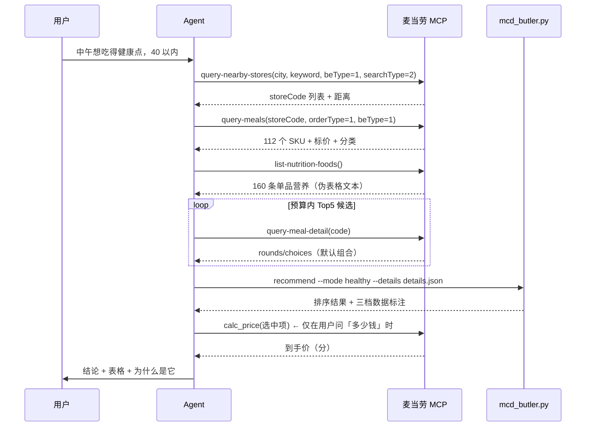
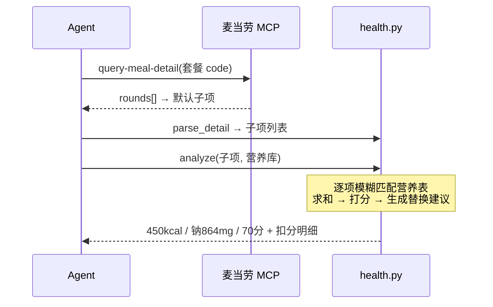
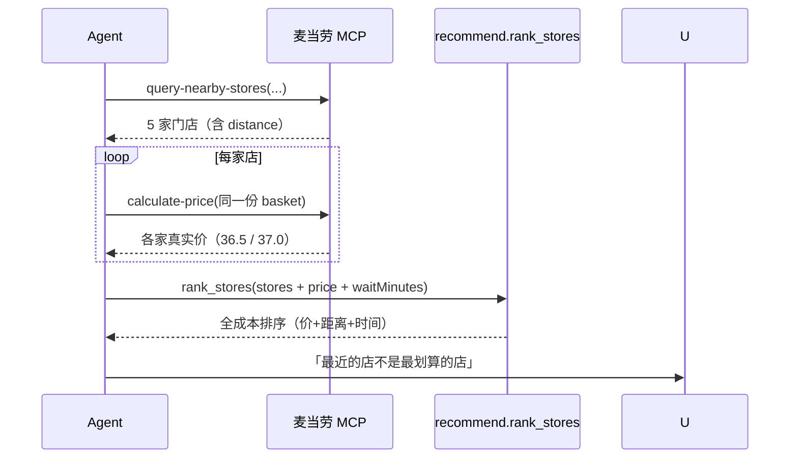
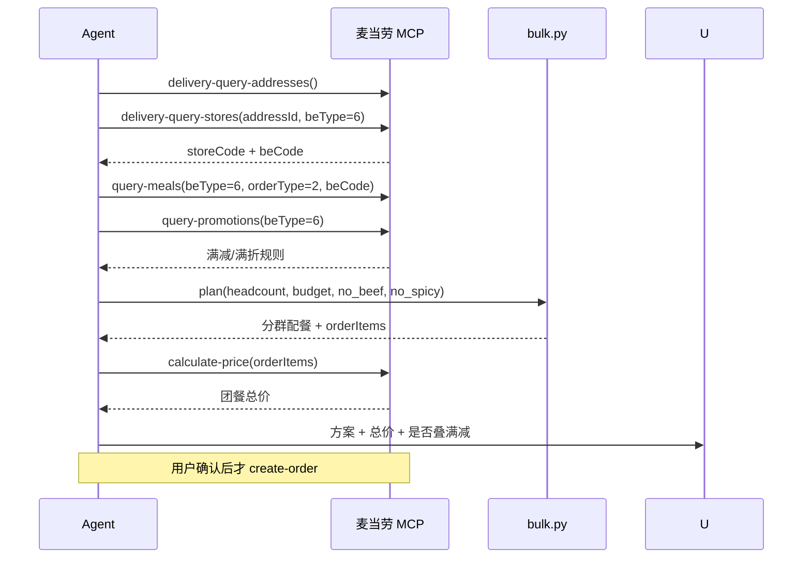
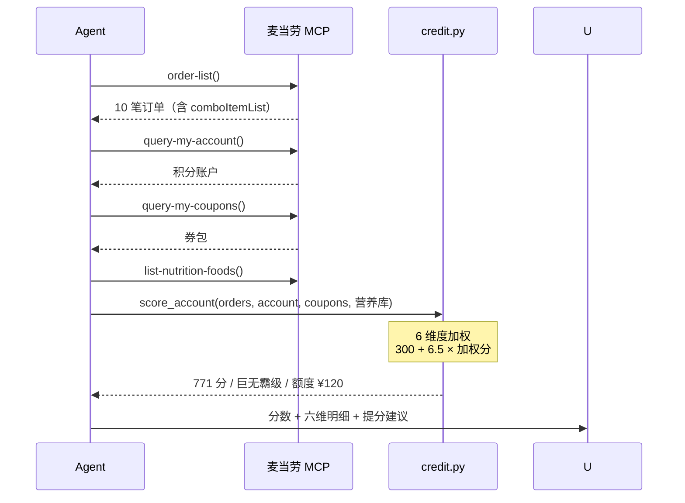
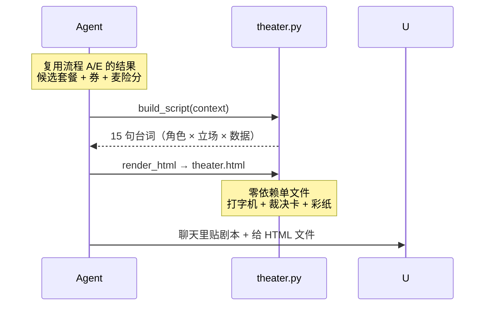

# MCP 集成说明

本文说明 McButler 实际使用了哪些麦当劳 MCP 能力、怎么串起来的、以及为什么这样串。

## 1. 接入信息

| 项 | 值 |
|---|---|
| MCP Server | `https://mcp.mcd.cn` |
| 传输协议 | Streamable HTTP |
| 鉴权 | `Authorization: Bearer <MCP_TOKEN>`（在麦当劳 MCP 控制台激活获取） |
| 本项目调用的工具数 | 15 个（核心链路 9 个 + 按场景启用 6 个） |
| 代码位置 | MCP 调用由 Agent 侧发起；`scripts/lib/*` 消费其原始响应 |

> 设计取舍：**本地脚本不直连 MCP**。
> 原因有三：① Token 不该出现在代码里；② 原始响应落盘后可离线复现、可单测；
> ③ 同一份计算结果既能给聊天用，也能给 HTML/报告复用。

## 2. 工具清单（按用途）

### 核心链路

| 工具 | 在 McButler 里的角色 | 关键返回字段 |
|---|---|---|
| `query-nearby-stores` | 到店场景取门店与距离 | `storeCode` `distance` `beCode` `reservation` |
| `query-meals` | 菜单、标价、分类、常点 | `categories` `meals{code}` `frequent` |
| `query-meal-detail` | **套餐拆解**（健康分析的前提） | `rounds[].choices[].isDefault/quantity` |
| `list-nutrition-foods` | 官方营养库 | `name` `kcal` `protein` `fat` `carb` `sodium` `calcium` |
| `calculate-price` | 到手价（含券/打包/运费） | `price`（分）`discount` `takeWayList` `enjoyed` |
| `query-my-coupons` | 券包 → 优惠利用率维度 | 券名、面额、渠道标签 |
| `query-my-account` | 积分 → 账户资产维度 | `availablePoint` `accumulativePoint` |
| `order-list` | 履约/节律/预算/多样性 | `orderStatus` `createTime` `realTotalAmount` `comboItemList` |
| `campaign-calendar` | 活动叠加建议 | 活动标题、内容、日期 |

### 按场景启用

| 工具 | 场景 |
|---|---|
| `delivery-query-addresses` → `delivery-query-stores` | 麦乐送 / 企业团餐选址（拿 `beCode`） |
| `query-store-coupons` | 已定门店后查「这个店真能用的券」 |
| `available-coupons` | 麦麦省可领取券，做「先去领券」的引导 |
| `query-promotions` | 团餐满减/满折规则（`beType=6` 专用） |
| `query-meal-assistance` | 团餐助餐服务码 `gmServiceCode` |
| `query-order` / `create-order` | 用户确认后的真实下单与状态追踪 |

完整参数坑见 [`references/mcp-tool-map.md`](../references/mcp-tool-map.md)。

## 3. 六条调用流程

### 流程 A：每日推荐（省钱 / 健康 / 人气）



### 流程 B：健康体检



### 流程 C：门店全成本比价



### 流程 D：团餐配餐



### 流程 E：麦险分



### 流程 F：麦门小剧场



## 4. 数据流：从原始响应到可用数字

```
MCP 原始响应                    mcdata.py 处理                 产物
─────────────────────────────────────────────────────────────────────────
{"success":true,"data":{...}}  → unwrap()                   → 纯 data
data.categories + data.meals   → Menu()                    → meals{code: {name, price, ...}}
data.rounds[].choices[]        → parse_detail()            → components[{name, qty}]
data = "[160]{...}:\n  ..."   → parse_nutrition()         → NutriDB（160 条）
order.list[].orderProductList  → parse_orders()            → 归一化订单
markdown 券列表                 → parse_coupons()           → coupons[{name, price, tags}]
```

两个刻意保留的「不规整」：

1. **营养表不是 JSON**，是逗号分隔的伪表格文本 —— 直接原样落盘成 `demo/nutrition.txt`，解析交给 `parse_nutrition()`。
2. **券包返回 markdown**，不是 JSON —— 同上，落成 `demo/coupons.md`。

这样「工具返回什么就存什么」，别人复现时不需要手工整理数据。

## 5. 业务价值

对用户：

- **少花冤枉钱**：门店全成本比价 + 每 100kcal 单价，避免了「便宜但折腾」和「便宜但没吃饱」两种隐性亏损。
- **吃得明白**：套餐热量第一次有了可核验的拆解路径，而不是靠猜。
- **团餐不再靠 Excel**：30 人的忌口、预算、口味，一次算完并直接产出下单参数。

对麦当劳：

| 价值点 | 机制 |
|---|---|
| 提升下单转化 | 把「不知道吃啥」直接收敛到一个带理由的结论 |
| 提升券核销 | 券包被主动纳入推荐排序（优惠利用率维度会「提醒」用户用券） |
| 带动高毛利组合 | 健康模式倾向「主餐 + 蔬果 + 无糖饮料」的完整套餐，而非单点 |
| 团餐 B 端渗透 | 分群配餐 + 满减叠加，降低企业客户的下单门槛 |
| 健康品牌心智 | 用官方营养数据做透明呈现，而不是营销话术 |

## 6. 错误处理

| 情况 | 处理 |
|---|---|
| 门店无 `beCode`（`beType=1`） | 后续调用一律不传 `beCode`，传了会报错 |
| `query-meals` 返回空（门店打烊/售罄） | 换门店或改预约时间，不编造菜单 |
| 营养表命中率 < 60% | 健康分降级标注「仅供参考」，并提示改用 `--combo` 拆解 |
| 完全无营养数据 | 不给分（`健康分 —`），不做假数字 |
| `calculate-price` 失败 | 回退到菜单标价并**明确说明是标价不是到手价** |
| 用户无历史订单 | 麦险分走冷启动规则（履约 40 / 节律 45 / 预算 45），并说明原因 |
| `create-order` | 仅在用户明确确认后调用；返回支付链接，用户回「已支付」再 `query-order` |

## 7. 安全与合规

- 仓库内**不含任何 Token**，配置示例统一使用 `Bearer YOUR_MCP_TOKEN` 占位符。
- demo 数据中的 `accountId`、`orderId` 为抓取时的真实值，仅用于演示解析逻辑；
  正式发布时如需脱敏，替换 `demo/account.json` 与 `demo/orders.json` 即可，不影响任何计算。
- 不采集、不上传用户数据；所有计算在本地完成。
- 营养结论标注「仅供参考」，不构成医疗建议。
