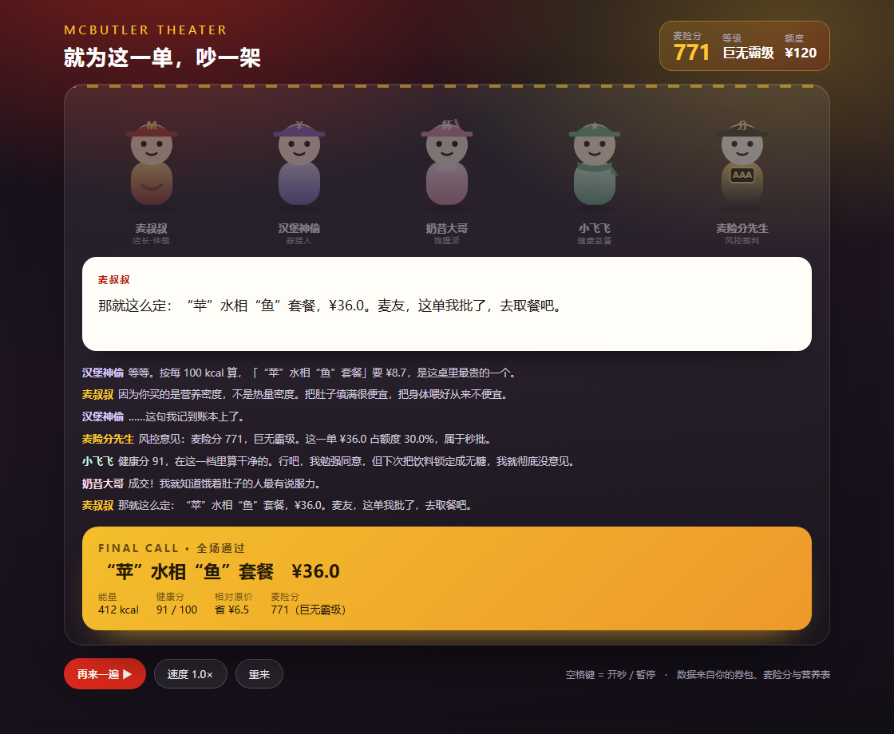

# 麦当劳自助管家 · McButler

> 一个基于麦当劳官方 MCP 的点单参谋：**帮你把「省钱」「健康」「省时间」三个约束同时解开**，
> 顺便用信贷评分卡的思路给你打个「麦险分」，并在等餐的三分钟里放一场五个小人吵架的小剧场。

参赛：麦当劳程序员节创意开发大赛 · 开发 Skill 赛道
MCP：`https://mcp.mcd.cn`（Streamable HTTP）

**在线体验小剧场** → https://jouaaaaaa.github.io/mcd-self-butler/demo/theater.html
**仓库** → https://github.com/jouaaaaaa/mcd-self-butler



---

## 一、它到底解决什么问题

不是「推荐一个套餐」这么简单。真实场景里，用户同时被三件事夹着：

| 场景 | 用户的真实处境 | 大多数工具的做法 | McButler 的做法 |
|---|---|---|---|
| **午休只有 40 分钟** | 想快、想吃好、不想多花钱 | 按价格排序 | 算「全成本」：商品价 + 走路时间 + 排队时间 |
| **在减脂但嘴馋** | 想要能吃的数据，不是「少吃点」 | 甩一个热量数字 | 拆套餐 → 逐项对营养表 → 给可执行的替换方案 |
| **部门 30 人团餐** | 预算、忌口、口味全都不一样 | 报一个总价 | 分群配餐，输出可直接算价的 `items` |

一句话：**别人帮你选一个餐，McButler 帮你把这一餐的所有约束一次性对平。**

---

## 二、六个能力

| # | 能力 | 命令 | 一句话说明 |
|---|---|---|---|
| 1 | 每日推荐 | `recommend` | 省钱 / 健康 / 人气三种模式，各自一套排序逻辑 |
| 2 | 健康体检 | `health` | 把套餐拆成子项逐项对表，输出热量·蛋白·脂肪·钠·钙 + 扣分明细 |
| 3 | 门店比价 | `stores` | 最近 / 最便宜 / 综合全成本 |
| 4 | 团餐配餐 | `bulk` | 按忌口与口味分群，N 人份自动配比，输出可直接下单的 items |
| 5 | 麦险分 | `credit` | 六维信贷评分卡，账户级 + 订单级双评级 |
| 6 | 麦门小剧场 | `theater` | 五个小人用你的券和信用分吵架，吵出最省钱方案 |

### 1. 每日推荐

三种模式不是换个排序字段，而是三套不同的价值函数：

- **省钱**：`0.55 × 价格归一 + 0.30 × 折扣力度 + 0.15 × 每 100kcal 单价`
  —— 用「每 100 kcal 多少钱」防止用小食刷低价格。
- **健康**：`0.75 × 健康分 + 0.25 × 能量贴合度`，并对有实测数据的候选加权 3 分。
- **人气**：`0.7 × 热度 + 0.3 × 折扣`，热度 = 爆款标签 + 你的历史常点。

### 2. 健康体检（本项目的技术核心）

麦当劳的营养接口只给**单品**，不给套餐。所以任何「巨无霸三件套 949 kcal」都必须自己算：

```
query-meal-detail("巨无霸三件套")
  └─ rounds[isDefault=1] → 巨无霸 / 中薯条 / 可乐中杯
      └─ list-nutrition-foods 逐项查表
          └─ 513 + 289 + 147 = 949 kcal · 钠 1126mg · 蛋白 31g
```

评分是 100 分制扣分：能量区间(30) + 蛋白质(20) + 脂肪供能比(20) + 钠(20) + 糖油负担(16) + 蔬果加分(+10)。
完整公式见 [`references/model-spec.md`](references/model-spec.md)。

**并且明确标注数据质量**：`实测` / `官方` / `估`。拿不到数据就不给分（`健康分 —`），绝不编数字。

### 3. 门店比价：我们不打价格战，我们打全成本

```
全成本 = 商品价 + 距离成本(往返 0.5 元/km) + 时间成本((步行往返 + 排队) × 0.30 元/分钟)
```

真实数据（同一份巨无霸三件套，三家店都是 ¥36.5）：

| 门店 | 距离 | 排队 | 全成本 |
|---|---|---|---|
| 静安锦沧文华 | 548m | 4min | **¥42.2** |
| 吴江路（离你最近） | 234m | 18min | ¥43.8 |
| 仙乐斯 | 1011m | 6min | ¥46.6 |

> 结论：走多 314 米，省 1.6 元和一个坏心情。最近的店不是最划算的店。

### 4. 团餐配餐

30 人 / 人均 30 元 / 5 人不吃牛 / 4 人不吃辣，输出：

```
分群：不吃牛 5 · 不吃辣 4 · 健康派 9 · 辣党 9 · 实惠派 3
合计 ¥772.8（原价 ¥1444.5，省 ¥671.7）人均 ¥25.8 · 人均 661 kcal · 5 个不同套餐
```

并且直接给出可串联 `calculate-price` 的 `orderItems`：

```json
[{"productCode": "9900015602", "quantity": 12},   // 大堡口福三件套
 {"productCode": "9900011128", "quantity": 6},    // "堡"你欢乐套餐
 {"productCode": "9900004835", "quantity": 3},    // 麦乐鸡套餐
 {"productCode": "9900000891", "quantity": 6},    // 麦辣鸡腿堡四件套
 {"productCode": "9900016309", "quantity": 3}]    // 龙焰鸡腿堡四件套
```

### 5. 麦险分（McCredit Score）

用消费信贷记分卡的思路，给**麦当劳账户**和**单笔订单**做信用评级。

| 维度 | 权重 | 映射自 |
|---|---|---|
| 履约稳定度 | 20% | 订单完成率 |
| 消费节律 | 15% | 下单时间规律性 + 活跃衰减 |
| 预算纪律 | 15% | 客单价波动系数 + 合理带 |
| 优惠利用率 | 15% | 券包厚度 + 渠道覆盖 |
| 账户资产 | 15% | 麦享会积分 |
| 口味多样性 | 20% | 品类熵 + 历史餐品健康度 |

输出 300-950 分，配六档等级（麦麦萌新 → 麦门之神），每一分都能追溯到具体数据。
示例账户实测 **771 分 · 巨无霸级**，拖后腿的是「消费节律」（89 天没下单）和「口味多样性」（历史全是炸鸡套餐）。

### 6. 麦门小剧场

等餐的 3-10 分钟是产品的空窗期。McButler 把它变成内容：

- 五个角色各代表一种真实立场：麦叔叔（仲裁）、汉堡神偷（券）、奶昔大哥（饱腹）、小飞飞（健康）、麦险分先生（风控）
- 台词由**用户自己的券、麦险分、热量数据**实时生成，吵出来的结论就是推荐结果
- 单文件 HTML，零依赖，双击即看：角色说话会晃、气泡逐字打出、结尾弹裁决卡撒彩纸

> 汉堡神偷：等等。按每 100 kcal 算，「"苹"水相"鱼"套餐」要 ¥8.7，是这桌里最贵的。
> 麦叔叔：因为你买的是营养密度，不是热量密度。把肚子填满很便宜，把身体喂好从来不便宜。

---

## 三、快速开始

### 方式 A：在 WorkBuddy 里当作 Skill 使用（推荐）

1. 把本仓库 `SKILL.md` 连同 `scripts/`、`references/` 放进 `~/.workbuddy/skills/mcd-self-butler/`
2. WorkBuddy 左侧 `专家·技能·连接器` → `连接器` → 右上角 `自定义连接器` → `配置 MCP`，粘贴：

```json
{
  "mcpServers": {
    "mcd-mcp": {
      "type": "streamablehttp",
      "url": "https://mcp.mcd.cn",
      "headers": { "Authorization": "Bearer 你的_MCP_TOKEN" }
    }
  }
}
```

3. 启用 `mcd-mcp`，然后直接说：
   - 「我在南京西路，附近哪家麦当劳买巨无霸三件套最划算？」
   - 「帮我看看这个套餐多少卡，有没有更健康的换法」
   - 「部门 30 人团餐，人均 30，5 个不吃牛」
   - 「我的麦险分多少？」
   - 「等餐好无聊，让他们吵一架」

### 方式 B：本地 CLI（不需要 Token，跑 demo 数据）

```bash
git clone <this-repo> && cd mcd-self-butler
python scripts/selftest.py            # 9 个用例，全绿说明环境 OK

python scripts/mcd_butler.py health --nutrition demo/nutrition.txt --combo demo/combo_9900011128.json
python scripts/mcd_butler.py recommend --menu demo/menu_1450118.json --nutrition demo/nutrition.txt \
  --mode healthy --meal lunch --budget 45 --top 5 --details demo/details.json
python scripts/mcd_butler.py credit --orders demo/orders.json --account demo/account.json \
  --coupons demo/coupons.md --nutrition demo/nutrition.txt
python scripts/mcd_butler.py bulk --menu demo/menu_1450118.json --nutrition demo/nutrition.txt \
  --headcount 30 --budget 30 --no-beef 5 --no-spicy 4
python scripts/mcd_butler.py stores --stores demo/stores.json --mode balanced
python scripts/mcd_butler.py theater --context demo/theater_context.json --out theater.html
```

只依赖 Python 3.8+ 标准库，**没有任何第三方依赖**。

### 方式 C：接自己的 MCP 客户端

任选：

1. 在客户端里跑 MCP 调用，把原始响应存成 `demo/` 里同名结构的 JSON；
2. 直接调用 `scripts/lib/*` 里的函数，把 MCP 返回的 dict 传进去。

`mcdata.py` 同时接受 **MCP 原始响应**（`{"success":true,"data":...}`）和人工精简格式，
所以「工具返回什么就存什么」即可，不需要手工整理。

---

## 四、真实输出（节选）

完整版见 [`examples/demo-output.md`](examples/demo-output.md)，全部为 2026-10-24 抓取的上海吴江路餐厅真实数据。

**健康体检 · "堡"你欢乐套餐**

| 组成 | kcal | 蛋白 g | 脂肪 g | 钠 mg |
|---|---|---|---|---|
| 汉堡包 | 248 | 13.0 | 8.0 | 492 |
| 麦乐鸡4块 | 170 | 10.0 | 10.0 | 337 |
| 苹果片一袋(60g) | 32 | 0.0 | 0.0 | 0 |
| 无糖可口可乐中杯 | 0 | 0.0 | 0.0 | 35 |
| **合计** | **450** | **23.0** | **18.0** | **864** |

> 健康分 70 / 100（B）· 能量占每日 22% · 钠占 43%
> 扣分项：能量偏低 −2.5 / 蛋白质 −10 / 脂肪供能比 36% −12 / 钠 −6 / 油炸 1 项 −4 / 蔬果 +5

**健康推荐**（实测数据说话）

| # | 餐品 | 现价 | 省 | 热量 | 健康分 |
|---|---|---|---|---|---|
| 1 | "苹"水相"鱼"套餐 | ¥36.0 | 33% | 实测 412 kcal | 91 |
| 2 | 牛气满满套餐 | ¥35.0 | 26% | 实测 495 kcal | 81 |
| 3 | 芝士安格斯厚牛堡 | ¥31.5 | — | 官方 696 kcal | 74 |

**麦险分**

```
771 / 950   巨无霸级   建议单笔额度 ¥120   履约风险 18.6%
履约 100 · 节律 54 · 预算 65 · 优惠 70 · 资产 90 · 多样性 53
```

---

## 五、架构

```
            ┌──────────────────────────────┐
            │  WorkBuddy Agent / 任意 MCP   │
            │  客户端                       │
            └──────────────┬───────────────┘
                           │ MCP (Streamable HTTP)
            ┌──────────────▼───────────────┐
            │      麦当劳 MCP Server        │
            │  门店 / 菜单 / 详情 / 营养     │
            │  算价 / 券 / 积分 / 订单       │
            └──────────────┬───────────────┘
                           │ 原始响应落盘
            ┌──────────────▼───────────────┐
            │   mcdata.py  数据载入层       │
            │   解包 · 归一化 · 模糊匹配     │
            └──────────────┬───────────────┘
        ┌──────────┬───────┼────────┬──────────┐
        ▼          ▼       ▼        ▼          ▼
     health     credit   bulk   recommend   theater
     健康度     麦险分    团餐    三模式推荐   小剧场
        └──────────┴───────┴────────┴──────────┘
                           ▼
                   mcd_butler.py CLI
                   Markdown / JSON 双输出
```

目录：

```
mcd-self-butler/
├── SKILL.md                    ← Skill 定义（Agent 的行为说明书）
├── README.md
├── MCP_INTEGRATION.md           ← MCP 工具、调用流程、业务价值
├── CONTEST_DECLARATION.md       ← 官方参赛声明（内容未改动）
├── workbuddy.md                 ← WorkBuddy 开发对话上下文
├── scripts/
│   ├── mcd_butler.py            ← 六条命令的统一入口
│   ├── selftest.py              ← 9 个离线用例
│   └── lib/
│       ├── mcdata.py            数据载入 + 名称归一化 + 营养库
│       ├── health.py            健康度评分
│       ├── credit.py            麦险分评分卡
│       ├── bulk.py              团餐分群配餐
│       ├── recommend.py         三模式推荐 + 门店全成本
│       └── theater.py           剧本生成 + HTML 渲染
├── references/
│   ├── model-spec.md            四个模型的公式与参数
│   └── mcp-tool-map.md          工具速查 + 参数坑
├── demo/                        真实抓取的数据快照（可离线复现）
│   ├── menu_1450118.json        菜单（112 个 SKU）
│   ├── nutrition.txt            营养表（160 条，MCP 原始文本）
│   ├── combo_*.json             4 个套餐详情
│   ├── orders.json              10 笔历史订单
│   ├── account.json / coupons.md / stores.json / price_*.json
│   └── theater.html             生成的小剧场（可直接打开）
├── examples/demo-output.md      全部命令的真实输出
└── docs/theater.png
```

---

## 六、关于「数据诚实」

参赛作品最容易翻车的地方是**编数字**。本项目的三条约束：

1. **三档数据标注**：`实测`（套餐拆解）/ `官方`（单品营养表）/ `估`（无数据粗估）。
   估算档会在表格里带「(估)」，输出说明里也写清楚。
2. **宁可交白卷**：一条营养数据都没命中时，`健康分 = —`，不给分，并提示改用 `--combo` 拆解。
3. **不假装是医疗建议**：所有营养结论都标注「仅供参考」，涉及疾病/孕期/儿童直接建议咨询专业人士。

同理，`waitMinutes`（排队时长）接口没有，代码里把它做成显式输入参数，demo 文件里也标注了「示例值」。

---

## 七、自测

```bash
$ python scripts/selftest.py
PASS  健康体检 · 拆解套餐并逐项对表
PASS  省钱推荐
PASS  健康推荐 · 应选出实测 412kcal 的鱼套餐
PASS  人气推荐
PASS  麦险分 · 六维评分卡
PASS  订单级麦险分
PASS  团餐配餐 · 30 人
PASS  门店全成本比价
PASS  麦门小剧场 · 纯文本剧本

全部 9 项通过 · 结论可复现
```

不需要 Token、不联网 —— 评委在自己机器上也能跑出同一组数字。

---

## 八、目标用户

| 用户 | 用得上的功能 |
|---|---|
| **写字楼午休党** | 门店全成本比价、省钱推荐（每 100kcal 单价） |
| **减脂/健身人群** | 健康体检、健康推荐、替换建议 |
| **行政 / HR / 班主任** | 团餐配餐、批量 items |
| **麦门老饕** | 麦险分、小剧场、活动日历 |
| **开发者** | 一套可复用的 MCP 数据解析层（`mcdata.py`）+ 可离线复现的 demo 数据 |

---

## 九、边界与后续

**已知边界**

- 未接入企业团餐的满减规则计算（`query-promotions` 已探通，未做叠加优化）
- 「不吃牛」按菜名关键词过滤，无法保证菜单未标注成分的餐品
- 排队时长需用户提供或估算

**下一步**

- 团餐叠满减：把 `query-promotions` 的规则接到 `bulk` 之后做二次优化
- 麦险分接入更多维度：跨店复购率、券核销率（需订单级券信息）
- 小剧场做成多人协作版：同事各自投一票，实时改写剧本

---

## 十、声明

- 本项目为麦当劳程序员节创意开发大赛参赛作品，由参赛者独立开发，**非麦当劳官方产品**。
- 餐品信息、价格、供应状态以麦当劳官方渠道实时结果为准。
- 营养分析基于麦当劳官方公开营养数据，仅供参考，**不构成医疗、营养或其他专业建议**。
- 项目不含任何真实 Token、密钥、账号凭证，配置仅使用环境变量占位符。

MIT License
